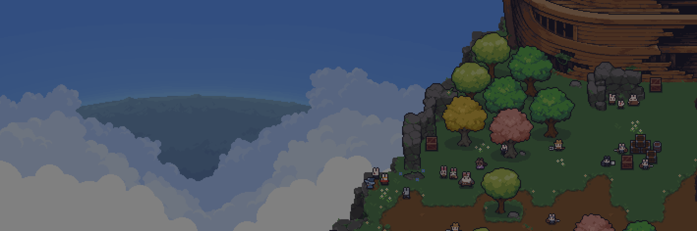

<p align="center">
  
</p>

<h1 align="center">세피리아 위키 · Sephiria Wiki</h1>

<p align="center">
  <strong>게임 정보 탐색부터 빌드 설계와 공유까지 연결하는 커뮤니티 웹 서비스</strong>
</p>

<p align="center">
  <a href="https://sephiria.wiki">서비스 바로가기</a> ·
  <a href="https://sephiria.wiki/builds">빌드 공유</a> ·
  <a href="https://sephiria.wiki/simulator">인벤토리 시뮬레이터</a> ·
  <a href="https://sephiria.wiki/stats">빌드 통계</a>
</p>

<p align="center">
  
  
  
  
  
</p>

---

## 프로젝트 소개

**세피리아 위키**는 액션 로그라이트 게임 *Sephiria*의 아이템·캐릭터 정보를 모아 제공하고, 유저가 직접 빌드를 구성하고 공유할 수 있도록 만든 **비공식 팬사이트**입니다.

처음에는 흩어져 있는 게임 정보를 쉽게 찾는 데 집중했습니다. 이후 이용자 피드백에서 **빌드 검색 및 공유 수요**를 확인해 빌드 공유 기능을 추가했고, 인벤토리 시뮬레이터·빌드 통계·퍼즐 콘텐츠까지 확장했습니다.

| 항목 | 내용 |
| --- | --- |
| 개발 형태 | **개인 프로젝트** · 기획, 프론트엔드 개발, 배포 및 운영 |
| 운영 기간 | **2025.09 ~ 현재** |
| 주요 사용자 경험 | 게임 정보 조회 → 빌드 실험 → 빌드 공유·검색 |
| 서비스 | **[sephiria.wiki](https://sephiria.wiki)** |

### 운영 기록

| 시기 | 주요 변화 | 일간 활성 사용자(DAU) |
| --- | --- | ---: |
| 2025.09 | 서비스 오픈 | 약 **300명** |
| 2025.10 | 빌드 공유 기능 공개 | 약 **3,000명** |
| 2026.08 | 게임 정식 출시 시기 | 약 **40,000명** |

> 운영 중 기록한 시기별 대략적인 수치입니다. 각 시기의 트래픽 변화가 특정 기능 하나의 효과를 의미하지는 않습니다.

---

## 주요 기능

### 1. 인벤토리 시뮬레이터

**[직접 체험하기](https://sephiria.wiki/simulator)**

게임의 인벤토리 메커니즘을 웹에서 실험할 수 있는 인터랙티브 시뮬레이터입니다.

- `@dnd-kit/core`를 이용해 석판과 아티팩트의 **배치, 이동, 교환, 삭제**를 지원합니다.
- 회전 가능한 석판은 **90° 단위 회전**을 적용하며, 주변 슬롯에 부여하는 효과를 다시 계산합니다.
- 인접 슬롯, 행·열, 위치 조건 등 **석판별 고유 규칙**에 따라 보정치를 합산합니다.
- 석판 배치에 따른 **아티팩트 최종 레벨과 효과 설명**을 실시간으로 반영합니다.
- 슬롯 수 조절, 아이템 검색·필터, **인벤토리 이미지 저장** 기능을 제공합니다.

**관련 코드:** [인벤토리 UI](./src/modules/simulator/ui/Inventory.tsx) · [효과 계산 훅](./src/features/simulator/model/useSlabsEffects.tsx) · [석판별 효과 핸들러](./src/features/simulator/config/getSlabsEffect.ts)

### 2. 빌드 공유 및 검색

**[직접 체험하기](https://sephiria.wiki/builds)**

이용자가 자신의 플레이 구성을 기록하고, 다른 사람의 빌드를 검색·비교할 수 있는 사용자 생성 콘텐츠(UGC) 기능입니다.

- **Discord OAuth** 로그인과 Supabase를 활용한 빌드 **등록·조회·수정·삭제**, 좋아요 및 마이페이지
- 캐릭터, 무기, 기적, 아티팩트, 콤보, 게임 버전 등 **다중 조건 검색·필터링**
- 제목·작성자 검색, 인기순·최신순 정렬, 최근 7/30일 필터와 **페이지네이션**
- 필터와 페이지 상태를 **URL 쿼리스트링에 동기화**해 검색 결과 공유 및 새로고침 시 상태 복원
- **React Hook Form + Zod**로 빌드 입력값과 재능 포인트 검증
- **Tiptap** 기반 서식 편집, 이미지 첨부, 게임 내 프리셋 코드 저장 및 열람

**관련 코드:** [빌드 목록](./src/modules/builds/ui/BuildsClientPage.tsx) · [URL 상태 동기화](./src/modules/builds/model/useSyncBuildQueryState.ts) · [입력 스키마](./src/modules/add-build/model/formSchema.ts)

### 3. 빌드 통계

**[직접 체험하기](https://sephiria.wiki/stats)**

공유된 빌드 데이터를 기반으로 캐릭터·무기·기적·아티팩트·재능·콤보의 **사용 빈도 및 비율**을 시각화합니다. 통계 항목을 선택하면 해당 조건의 빌드 검색으로 이어지도록 연결했습니다.

**관련 코드:** [통계 화면](./src/modules/stats/ui/StatsClientPage.tsx) · [통계 조회](./src/entities/stats/api/getBuildItemUsageStats.ts)

### 4. 석판 퍼즐과 게임 데이터 도감

- **[석판 퍼즐](https://sephiria.wiki/slab-puzzle):** 시뮬레이터의 석판 효과 로직을 재사용해 **3단계 제한 시간 퍼즐**과 로그인 사용자 랭킹을 구현했습니다.
- **게임 정보 도감:** 캐릭터(코스튬), 무기, 기적, 아티팩트, 석판, 재능, 콤보 정보를 탐색할 수 있는 화면을 제공합니다.

**관련 코드:** [퍼즐 게임](./src/modules/slab-puzzle/ui/SlabPuzzleGame.tsx) · [랭킹 API](./src/app/api/slab-puzzle/rankings/route.ts)

---

## 기술적으로 고민한 부분

### 01. 게임 규칙을 좌표 기반 계산 모델로 구현

**문제:** 석판마다 영향 범위와 발동 조건이 다르고, 일부는 회전할 수 있어 UI에 효과 계산을 직접 결합하면 규칙 추가와 수정이 어려워집니다.

**접근:**
- 석판 효과를 **상대 좌표(`dx`, `dy`)**로 표현하고 회전 방향에 따라 좌표를 변환했습니다.
- 석판 종류마다 독립적인 **효과 핸들러**를 두어 일반적인 위치 보정과 예외적인 조건 처리를 분리했습니다.
- 배치 상태가 바뀌면 `useMemo`를 통해 슬롯 보정치와 아티팩트 최종 효과를 계산하도록 구성했습니다.

**결과:** 사용자 인터랙션과 게임 규칙 계산을 분리해, 석판 종류가 늘어나더라도 효과 로직을 개별적으로 관리할 수 있는 구조를 만들었습니다.

**코드:** [좌표 회전·효과 계산](./src/features/simulator/lib/calculateEffects.ts) · [상태와 파생 값 계산](./src/features/simulator/model/useSlabsEffects.tsx)

### 02. 검색 경험과 데이터 조회 비용을 함께 고려

**문제:** 빌드 검색 조건이 늘어나면 화면 상태와 URL이 어긋나기 쉽고, 여러 사용자가 동일한 목록을 조회하면서 데이터베이스 요청이 반복될 수 있습니다.

**접근:**
- **Zustand**로 검색 상태를 관리하고 URL 쿼리스트링과 동기화했습니다.
- Supabase 쿼리에 조건별 필터·정렬·범위 기반 페이지네이션을 적용했습니다.
- 클라이언트에서는 **TanStack Query**, 서버에서는 Next.js **`unstable_cache`**를 사용했습니다.
- 빌드 등록·수정·삭제·좋아요 변경 시 **`revalidateTag`**로 관련 목록 및 상세 데이터 캐시를 무효화했습니다.

**결과:** 여러 필터 조합을 공유 가능한 URL로 유지하면서, 캐시 재사용과 변경 데이터 반영을 함께 고려한 조회 구조를 구현했습니다.

**코드:** [검색 상태 동기화](./src/modules/builds/model/useSyncBuildQueryState.ts) · [쿼리 및 캐시](./src/entities/builds/api/buildsCache.ts) · [빌드 API](./src/app/api/builds/route.ts)

### 03. 이용자 작성 콘텐츠의 안전성과 이미지 관리

**문제:** 이용자별 수정 권한, 서식 있는 HTML 입력, 이미지 업로드 및 삭제가 함께 존재하는 기능에서는 권한 검증과 데이터 정리가 중요합니다.

**접근:**
- **Supabase Auth**로 로그인 사용자를 확인하고, 수정·삭제 API에서 **작성자 또는 관리자 권한**을 검사했습니다.
- Tiptap 에디터 입력은 서버에서 **`sanitize-html`**로 허용 태그·스타일·이미지 출처를 제한했습니다.
- 이미지 업로드 전에 크기와 형식을 검증하고 일반 이미지를 **WebP로 압축**했습니다.
- 게시글 수정·삭제 및 작성 취소 과정에서 **사용하지 않는 이미지를 정리**하도록 구현했습니다.

**결과:** 작성 경험을 확장하면서도 서버 측 권한 검증과 저장소 정리 흐름을 유지했습니다.

**코드:** [게시글 수정·삭제 API](./src/app/api/builds/%5Bid%5D/route.ts) · [HTML 정제](./src/shared/model/buildDescriptionHtml.ts) · [이미지 업로드](./src/features/add-build/lib/buildImageUpload.ts)

### 04. 서비스 운영을 고려한 정적 리소스와 검색 노출

- 게임 이미지의 제공 경로를 **Cloudflare R2 기반 에셋 도메인**으로 분리하고, 기존 이미지 URL도 대응하도록 변환 유틸리티를 구성했습니다.
- 정적 파일에 **장기 브라우저 캐시 헤더**를 적용했습니다.
- 빌드 상세 페이지별 **메타데이터·Open Graph·canonical URL**, 게시글을 포함하는 **동적 sitemap.xml**을 제공했습니다.
- **Vercel** 배포 환경에서 서비스를 운영하고, Google Analytics와 AdSense를 연동했습니다.

**코드:** [이미지 URL 처리](./src/shared/utils/image.ts) · [캐시 헤더](./next.config.ts) · [동적 사이트맵](./src/app/sitemap.xml/route.ts) · [메타데이터](./src/app/builds/%5Bid%5D/page.tsx)

---

## 기술 스택

| 구분 | 기술 |
| --- | --- |
| **Frontend** | Next.js 15 (App Router), React 19, TypeScript |
| **UI / Styling** | Tailwind CSS 4, shadcn/ui (Radix UI), Lucide React |
| **상태·서버 데이터** | Zustand, TanStack Query v5 |
| **폼·콘텐츠 편집** | React Hook Form, Zod, Tiptap |
| **인터랙션** | dnd-kit, html-to-image |
| **Backend / Auth** | Supabase (PostgreSQL, Auth, Storage), Next.js Route Handlers |
| **배포·에셋** | Vercel, Cloudflare R2 |
| **개발 도구** | Biome |

## 프로젝트 구조

Next.js App Router를 기반으로, **Feature-Sliced Design에서 영감을 받은 역할별 폴더 구조**를 사용했습니다.

```text
src/
├── app/       # 페이지, 라우팅, Route Handlers
├── modules/   # 페이지 단위의 복합 UI와 화면 상태
├── features/  # 검색, 빌드 작성, 시뮬레이터 등 기능 로직
├── entities/  # 빌드, 아티팩트, 무기 등 도메인 데이터 및 API
└── shared/    # 공통 UI, 유틸리티, 설정, 프로바이더

lib/supabase/   # 브라우저·서버 Supabase 클라이언트
supabase/       # Supabase Edge Functions
```

## 로컬 실행

```bash
git clone https://github.com/WhiteDog1004/sephiria.git
cd sephiria
npm install
```

프로젝트 루트에 `.env.local`을 만들고 **개발용 Supabase 프로젝트**의 설정을 입력합니다.

```dotenv
NEXT_PUBLIC_SUPABASE_URL=
NEXT_PUBLIC_SUPABASE_ANON_KEY=
NEXT_SUPABASE_SERVICE_ROLE=
NEXT_PUBLIC_GAME_VERSION=0.0.0
NEXT_PUBLIC_ASSET_BASE_URL=https://img.sephiria.wiki
```

```bash
npm run dev
```

> DB 테이블, Storage 버킷, 인증 제공자 등 Supabase 리소스의 별도 구성이 필요합니다. 서비스 역할 키(`NEXT_SUPABASE_SERVICE_ROLE`)는 **서버 전용 비밀값**이며 저장소나 클라이언트 코드에 노출해서는 안 됩니다.

---

<sub>이 프로젝트는 **TEAM HORAY의 공식 서비스가 아닌 비공식 팬사이트**입니다. 게임 및 관련 이미지·상표의 권리는 각 권리자에게 있습니다.</sub>
